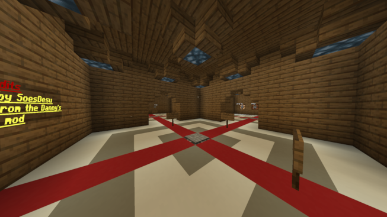
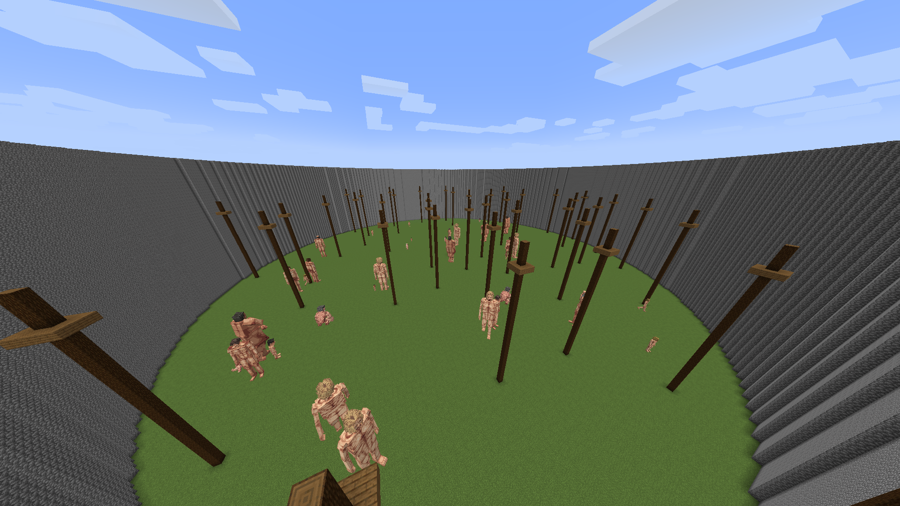

# DAOT-Titan-Practice
- Version: 1.21.1
- Mod loader: Neoforge

## Simple titan killing practice map
- [Map download](https://github.com/SoesDesu/DAOT-Titan-Practice/releases)
- [Sinytra Connector](https://www.curseforge.com/minecraft/mc-mods/sinytra-connector) (required)
- [Danny's AOT mod](https://modrinth.com/mod/dannys-aot) (required)
- [Legendary Survival Overhaul](https://modrinth.com/mod/legendary-survival-overhaul) (required)

## Feedback
- [SoesDesu](https://discordapp.com/users/894617827007397908) on Discord

## Installations:
1. Create a 1.21.1 Neoforge instance
2. Download and install the required mods
3. Download the lastest release of the map (.zip file)
4. Put the zip file into your .minecraft/saves folder

# Features:
- Timer to track your progress
- Customizable gamerules
- Customize the amount of titans
- Customize and choose your loadout
- Multiple maps to play on
# WIPs:
- Personal best time leaderboard

> 

